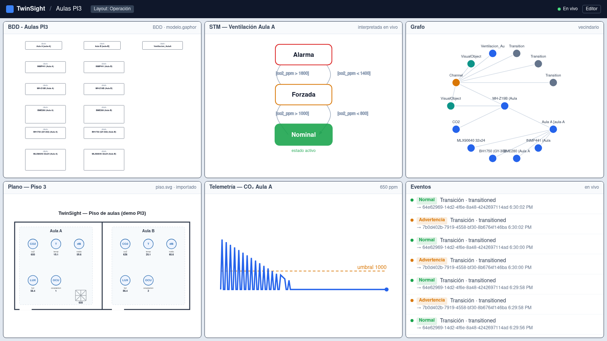

<div align="center">

# TwinSight

**Plataforma open source de visualización y modelado de gemelos digitales**

Unifica en un solo lugar el modelo SysML, la representación física y la telemetría IoT
en tiempo real — con mapeo tripartito, comportamiento model-driven y análisis de impacto.
Una alternativa abierta a herramientas como G2/NPAS.



</div>

---

## ¿Qué resuelve?

En un gemelo digital la información vive fragmentada: el **modelo SysML** en una herramienta
(Gaphor), la **representación física** en otra (AutoCAD/Inkscape), y la **telemetría** en
dashboards desconectados del modelo. TwinSight importa las tres y las vincula explícitamente:
al pasar el cursor sobre un sensor en el plano se resaltan su bloque SysML, su estado y su
serie de datos; cuando una máquina de estados del modelo transiciona en vivo, el impacto se
ilumina en todas las vistas a la vez.

## Características (MVP)

- **Importación SysML** `.gaphor` (solo lectura): bloques, propiedades, requisitos, paquetes,
  diagramas con geometría y **máquinas de estado con guardas**.
- **Representación física importada**: SVG (formas seleccionables, metadata `dt:*`, capas por
  estado `estado:*`) e imagen con anclas.
- **Comportamiento model-driven**: las guardas de las máquinas de estado (`co2_ppm > 1000`) se
  interpretan en vivo contra la telemetría mapeada.
- **Grafo canónico + análisis de impacto** (Neo4j): "¿qué afecta la falla de este sensor?".
- **Mapeo tripartito** en tres niveles: metadata embebida, convención de nombres y editor manual.
- **Workspace de paneles componibles** con resaltado cruzado, panel Grafana embebido y layouts.
- **Ingesta MQTT** (broker externo) + simulador incluido; **bundle portable** `.dtproj`;
  **acceso por niveles** editor/operador/viewer.

## Quickstart (demo de dos salones)

Requisitos: **Docker** y **Docker Compose**.

```bash
docker compose -f docker-compose.demo.yml up --build
```

Levanta un broker Mosquitto de juguete, Neo4j, el backend y un simulador que publica
telemetría de dos aulas con 5 sensores cada una. Abre **http://localhost:8000** y entra al
proyecto *Aulas PI3*. Sube el CO₂ simulado y observa cómo la máquina de estados *Ventilación*
pasa a *Forzada* en vivo y el impacto se resalta en todos los paneles.

> La clave de editor de la demo es `editor-demo` (configurable por `TWINSIGHT_EDITOR_KEY`).

## Desarrollo

```bash
# Backend
cd backend
uv sync --extra dev
uv run pytest
uv run uvicorn twinsight.app.main:app --reload

# Frontend
cd frontend
npm install
npm run dev
```

## Documentación

- [`ARCHITECTURE.md`](ARCHITECTURE.md) — arquitectura, dual-store y decisiones de diseño.
- [`docs/`](docs/) — instalación, contrato MQTT, convenciones de mapeo/metadata/capas,
  sintaxis de guardas, formato `.dtproj`, niveles de acceso.
- [`CONTRIBUTING.md`](CONTRIBUTING.md) — cómo contribuir y convención de commits.

## Estado y roadmap

Esta primera versión es un **vertical slice funcional**: core de backend, workspace, demo de
dos salones y tests. En el roadmap: instalador nativo (TwinSight Setup) con servicio y bandeja,
representación 3D (IFC/glTF/OBJ), importadores DXF/IFC, PWA offline y RBAC con cuentas
individuales. Ver [`docs/roadmap.md`](docs/roadmap.md).

## Licencia

[MIT](LICENSE) © 2026 jdluques
